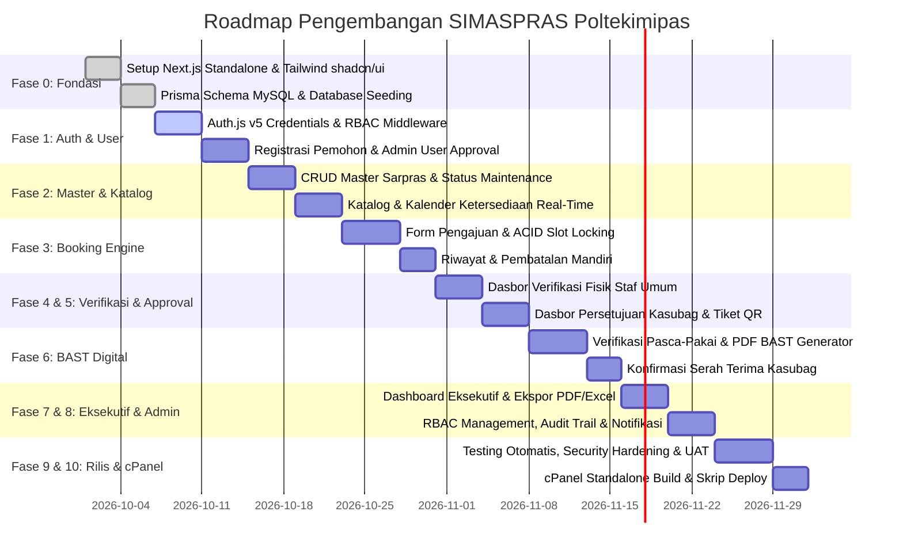

# Backlog Pengembangan SIMASPRAS Poltekimipas
> **Sistem Informasi Peminjaman Sarana dan Prasarana — Politeknik Imigrasi dan Pemasyarakatan Indonesia**  
> *Panduan Langkah Demi Langkah (Step-by-Step Development Guidance) Berdasarkan [PRD_Aplikasi_Peminjaman_Sarpras_Poltekimipas.md](file:///root/simaspras_v2-app/PRD_Aplikasi_Peminjaman_Sarpras_Poltekimipas.md)*

---

## 1. Ikhtisar & Prinsip Kolaborasi

Dokumen backlog ini dirancang sebagai acuan kerja terstruktur, bertahap, dan terverifikasi untuk mengembangkan aplikasi **SIMASPRAS (Sistem Informasi Peminjaman Sarana dan Prasarana)** Poltekimipas. Seluruh item diturunkan secara langsung dari 10 Use Case (UC-01 s/d UC-10), 8 Entitas ERD, 10 Activity Diagram, 10 Sequence Diagram, dan 10 Layout UI yang tercantum dalam PRD.

### 1.1 Profil Sistem & Batasan Teknis
* **Kerangka Kerja Utama:** Next.js 14+ (App Router), TypeScript (Strict Mode), Tailwind CSS, shadcn/ui.
* **Database & ORM:** MySQL 8.0+ / MariaDB 10.5+ (InnoDB Engine), Prisma ORM.
* **Autentikasi & Otorisasi:** Auth.js (NextAuth v5) Credentials Provider + JWT Session + Middleware RBAC (9 Peran).
* **Layanan Dokumen & Media:**
  * Generator Kode QR: `qrcode` (Pure JS).
  * Generator PDF: `@react-pdf/renderer` (In-process, ramah cPanel tanpa Puppeteer/Chromium).
  * Generator Spreadsheet: `exceljs`.
  * Email Notifikasi: `nodemailer` via SMTP Akun cPanel.
  * Penyimpanan File: Filesystem lokal aman di luar `public_html`, diproteksi Route Handler ber-RBAC.
* **Target Infrastruktur:** Shared Hosting berbasis cPanel dengan Node.js Selector (Phusion Passenger) via `server.js` (`output: 'standalone'`).

### 1.2 Definisi Selesai (Definition of Done - DoD)
Setiap tugas/item backlog dinyatakan **selesai (Done)** hanya jika memenuhi kriteria:
1. **Fungsional Sesuai PRD:** Alur logika mencakup Skenario Utama dan Skenario Alternatif/Pengecualian pada Use Case terkait.
2. **Kesesuaian Tipe Data:** Validasi Zod diterapkan secara konsisten di client-side (React Hook Form) dan server-side (Route Handlers / Server Actions).
3. **Pemberlakuan RBAC & Audit Trail:** Akses rute/API divalidasi berdasarkan matriks hak akses 9 peran; mutasi data kritikal tercatat otomatis pada tabel `audit_log`.
4. **Kompatibilitas cPanel:** Tidak menambahkan dependensi native binary atau layanan eksternal berbayar yang melanggar batasan shared hosting.
5. **Verifikasi & Pengujian:** Lolos verifikasi manual/otomatis sesuai *Acceptance Criteria* (§15 PRD).

---

## 2. Matriks Penelusuran (Traceability Matrix)

| Use Case | Nama Use Case | Aktor Utama | Layanan / Modul | Layout UI | Item Backlog |
|:---:|---|---|---|:---:|:---:|
| **UC-01** | Login, Registrasi & Autentikasi | Seluruh 9 Aktor | Auth.js, Mailer | UI-01 | EPIC-01 |
| **UC-02** | Cek Ketersediaan & Katalog Sarpras | Pemohon (Dosen, Taruna, BPSDM, Kemen, Alumni) | Sarpras Engine, FullCalendar | UI-02 | EPIC-02 |
| **UC-03** | Pengajuan Peminjaman Digital | Pemohon Sarpras | Booking Engine, Locking ACID | UI-03 | EPIC-03 |
| **UC-04** | Pembatalan Peminjaman Mandiri | Pemohon Sarpras | Booking Engine, Slot Releaser | UI-04 | EPIC-03 |
| **UC-05** | Persetujuan / Approval Sarpras | Kasubag Umum | Approval Engine, QR Generator | UI-05 | EPIC-05 |
| **UC-06** | Verifikasi Fisik & Jadwal Sarpras | Staf Bagian Umum | Inspection Engine | UI-06 | EPIC-04 |
| **UC-07** | Konfirmasi Serah Terima (BAST) | Kasubag Umum | BAST Engine, React-PDF, QR Sign | UI-07 | EPIC-06 |
| **UC-08** | Monitoring Dashboard & Laporan | Kabag Keuangan & Umum | Aggregation Engine, Recharts, ExcelJS | UI-08 | EPIC-07 |
| **UC-09** | Kelola Master Data Sarpras | Administrator | Inventory CRUD, Soft Delete | UI-09 | EPIC-02 |
| **UC-10** | Kelola User, Role & Audit Trail | Administrator | User Mgmt, RBAC Matrix, Audit Logger | UI-10 | EPIC-01, EPIC-08 |

---

## 3. Rincian Langkah Demi Langkah (Step-by-Step Backlog)

### FASE 0: Inisialisasi Proyek, Arsitektur Dasar & Skema Basis Data

- [x] **TASK-0.1: Setup Repositori & Inisialisasi Next.js Standalone**
  * **Deskripsi:** Menginisialisasi proyek Next.js dengan App Router, TypeScript (strict mode), Tailwind CSS, dan konfigurasi `next.config.js` (`output: 'standalone'`).
  * **Spesifikasi Teknis:**
    * Inisialisasi struktur direktori `/src` (`/app`, `/components`, `/lib`, `/types`, `/hooks`, `/server`).
    * Konfigurasi Passenger startup file `server.js` untuk kompatibilitas deployment cPanel.
    * Konfigurasi path aliases (`@/*`).
  * **Kriteria Keberhasilan:** Proyek dapat di-*build* dengan `npm run build` dan menghasilkan folder standalone yang siap dijalankan Node.js 20.

- [x] **TASK-0.2: Setup UI Design System (shadcn/ui & Theme)**
  * **Deskripsi:** Instalasi dan konfigurasi shadcn/ui dengan Tailwind CSS, Radix UI primitives, `lucide-react`, dan dukungan `next-themes` (Light/Dark mode).
  * **Komponen yang disiapkan:** Button, Card, Dialog, Sheet, Form, Input, Select, Checkbox, RadioGroup, Table, Tabs, Badge, Calendar, Toast (Sonner), Alert, DropdownMenu.
  * **Kriteria Keberhasilan:** Komponen terpasang rapi di `@/components/ui`, palet status badge standar (Kuning/Pending, Biru/Disetujui, Merah/Ditolak, Abu-abu/Dibatalkan, Hijau/Selesai) berfungsi.

- [x] **TASK-0.3: Konfigurasi Prisma ORM & Database Schema (MySQL/MariaDB)**
  * **Deskripsi:** Membuat skema `schema.prisma` (`provider = "mysql"`) yang memetakan 8 tabel DDL (§9.4, §9.7) secara 1:1.
  * **Entitas yang Dimodelkan:**
    * `User` (`users`): id_user (UUID), nama_lengkap, email (unique), password_hash, no_hp, role (enum), status_aktivasi (enum), created_at.
    * `PemohonDetail` (`pemohon_detail`): id_pemohon, id_user (FK unique cascade), nomor_identitas, instansi_kategori.
    * `Sarpras` (`sarpras`): id_sarpras, kode_aset (unique), nama_sarpras, kategori (enum), spesifikasi (text), lokasi_plat, status_operasional (enum).
    * `Peminjaman` (`peminjaman`): id_peminjaman, kode_transaksi (unique), id_pemohon, id_sarpras, id_approver, tgl_mulai, tgl_selesai, maksud_kegiatan, status_transaksi, created_at.
    * `TiketDigital` (`tiket_digital`): id_tiket, id_peminjaman (FK unique cascade), kode_qr (unique), status_tiket.
    * `VerifikasiFisik` (`verifikasi_fisik`): id_verifikasi, id_peminjaman, id_staf, jenis_pemeriksaan, kondisi_fisik, catatan_inspeksi, created_at.
    * `BASTDigital` (`bast_digital`): id_bast, nomor_bast (unique), id_peminjaman (FK unique restrict), id_kasubag, qr_signature, created_at.
    * `AuditLog` (`audit_log`): id_log (BigInt autoincrement), id_user, aktivitas, ip_address, timestamp.
    * **Indeks:** `idx_peminjaman_jadwal`, `idx_peminjaman_pemohon`, `idx_users_role_status`, `idx_audit_log_timestamp`.
  * **Kriteria Keberhasilan:** Skrip migrasi berhasil dijalankan tanpa error dan relasi tabel (FK, CASCADE, RESTRICT) sesuai spesifikasi DDL PRD.

- [x] **TASK-0.4: Database Seeding & Mock Data Awal**
  * **Deskripsi:** Membuat berkas `prisma/seed.ts` untuk mempopulasi data akun default (Admin, Kasubag, Staf) dan aset master awal (Ruangan, Mobil Operasional, Perangkat Kerja) sesuai DDL §9.7.
  * **Kriteria Keberhasilan:** Perintah `npx prisma db seed` berhasil membuat akun admin aktif dan 3 sampel aset sarpras dengan hash password aman.

- [x] **TASK-0.5: Utilitas Audit Logging & Helper Response**
  * **Deskripsi:** Membangun *shared helper* API response `{ success, data, message, errors }` dan fungsi helper `logAudit(id_user, aktivitas, ip_address)` untuk standardisasi penulisan log keamanan otomatis.
  * **Kriteria Keberhasilan:** Fungsi audit logger dapat mencatat riwayat ke tabel `audit_log` secara transaksional.

---

### FASE 1: Autentikasi, Registrasi Mandiri & RBAC 9 Peran (UC-01, UC-10 Bagian 1)

- [x] **TASK-1.1: Setup Autentikasi Auth.js (NextAuth v5) & Session Guard**
  * **Deskripsi:** Mengimplementasikan Credentials Provider dengan validasi email, password (bcrypt), dan verifikasi `status_aktivasi === 'Aktif'`.
  * **Spesifikasi Teknis:**
    * JWT session callback yang menyematkan `id_user`, `email`, `nama_lengkap`, `role`, dan `status_aktivasi`.
    * Middleware guard di `/middleware.ts` untuk memblokir rute privat berdasarkan role RBAC (§5.2).
    * Penolakan akun jika status `Pending` dengan pesan spesifik *"Akun Anda Belum Diaktifkan oleh Administrator"*.
  * **Kriteria Keberhasilan:** Sesi tersimpan aman pada HTTP-only cookie; pengguna tanpa hak akses dicegat dan diarahkan ke rute yang sesuai.

- [x] **TASK-1.2: Endpoint & Formulir Registrasi Pengguna Baru (UI-01)**
  * **Deskripsi:** Membangun antarmuka dan API endpoint `/api/auth/register` untuk pendaftaran mandiri (Dosen, Taruna, BPSDM, Kementerian, Alumni).
  * **Spesifikasi Teknis:**
    * Skema Zod pendaftaran: nama lengkap, email, password (min. 8 karakter), no HP, kategori peran, nomor identitas (NIP/NIM/NIK), instansi/jurusan.
    * Akun otomatis berstatus `status_aktivasi = 'Pending'`.
    * Mengisi tabel `users` dan `pemohon_detail` secara atomik (`prisma.$transaction`).
    * Notifikasi toast berhasil dan pengarahan ke halaman login dengan keterangan menunggu aktivasi Admin.
  * **Kriteria Keberhasilan:** Pengguna dapat mendaftar mandiri; data tersimpan di DB berstatus Pending tanpa bisa langsung login.

- [x] **TASK-1.3: Antarmuka Login Gateway & Pengalihan Dasbor Berbasis Peran (UI-01)**
  * **Deskripsi:** Membangun halaman login responsif dengan pesan status akun yang jelas.
  * **Aturan Pengalihan (Redirect Rules):**
    * `Kabag` → `/dashboard/eksekutif`
    * `Kasubag` → `/dashboard/approval`
    * `Staf` → `/dashboard/verifikasi`
    * `Admin` → `/admin/users`
    * `Dosen` / `Taruna` / `BPSDM` / `Kementerian` / `Alumni` → `/katalog`
  * **Kriteria Keberhasilan:** Login sukses mengarahkan setiap peran ke dasbor yang sesuai; penanganan kredensial salah dan akun pending menampilkan feedback yang ramah.

- [x] **TASK-1.4: Modul Manajemen Aktivasi Akun Pengguna oleh Admin (UC-10, UI-10 Tab 1)**
  * **Deskripsi:** Membangun antarmuka Tab "Pending Aktivasi" pada dashboard Admin (`/admin/users`) beserta endpoint PATCH `/api/admin/users/:id/aktivasi`.
  * **Spesifikasi Teknis:**
    * Menampilkan daftar pendaftar berstatus `Pending` beserta detail identitas (NIP/NIM, instansi).
    * Tombol aksi **Setujui** (mengubah status ke `Aktif`, mengirim email notifikasi via SMTP cPanel, mencatat `audit_log`).
    * Tombol aksi **Tolak** (dialog alasan penolakan, mengubah status ke `Ditolak`, mengirim email penjelasan, mencatat `audit_log`).
  * **Kriteria Keberhasilan:** Akun yang disetujui Admin seketika dapat login; akun yang ditolak tetap tidak dapat login; email notifikasi terkirim.

---

### FASE 2: Master Data Sarpras & Katalog Kalender Real-Time (UC-02, UC-09)

- [x] **TASK-2.1: Modul Kelola Master Data Sarpras oleh Admin (UC-09, UI-09)**
  * **Deskripsi:** Membangun halaman CRUD `/admin/sarpras` untuk 3 kategori: Ruangan, Mobil Operasional, dan Perangkat Kerja.
  * **Spesifikasi Teknis:**
    * DataTable (TanStack Table) dengan pencarian, filter kategori, dan status operasional (`Tersedia`, `Maintenance`, `Rusak`, `Non-Aktif`).
    * Modal Dialog **Tambah/Edit Sarpras** dengan validasi keunikan `kode_aset` BMN.
    * Aksi **Hapus Sarpras**: Cek relasi transaksi peminjaman aktif. Jika ada transaksi terkait, lakukan **Soft Delete** (`status_operasional = 'Non-Aktif'`); jika tidak ada, lakukan penghapusan permanen.
    * Toggle **Status Maintenance**: Saat aset diatur ke Maintenance, aset otomatis terkunci dari katalog peminjaman publik.
    * Setiap aksi mutasi mencatat entri ke `audit_log`.
  * **Kriteria Keberhasilan:** Administrator dapat menambah, mengedit spesifikasi, mengubah status maintenance, dan menghapus/menonaktifkan aset secara aman.

- [x] **TASK-2.2: Endpoint REST Katalog & Kalender Ketersediaan Sarpras**
  * **Deskripsi:** Membangun Route Handler `/api/sarpras` dan `/api/sarpras/:id/ketersediaan` (GET).
  * **Spesifikasi Teknis:**
    * Endpoint menyajikan daftar sarpras aktif (`status_operasional != 'Non-Aktif'`).
    * Endpoint ketersediaan mengagregasi data jadwal peminjaman (`status_transaksi IN ('Pending', 'Disetujui')`) pada rentang tanggal terpilih.
    * Mengembalikan slot waktu dengan penanda status: `Tersedia`, `Reserved` (Pending), `In Use` (Disetujui), atau `Maintenance`.
  * **Kriteria Keberhasilan:** Query ketersediaan jadwal memanfaatkan indeks komposit `idx_peminjaman_jadwal` dengan waktu respons < 500 ms.

- [x] **TASK-2.3: Antarmuka Katalog Sarpras & Kalender Ketersediaan Real-Time (UI-02)**
  * **Deskripsi:** Membangun halaman `/katalog` bagi pemohon dengan navigasi Tabs per kategori (Ruangan, Mobil, Perangkat).
  * **Spesifikasi Teknis:**
    * Kartu informasi aset menampilkan foto/ikon representatif, nama fasilitas, kode BMN, lokasi/lantai/plat, dan badge status ketersediaan.
    * Tampilan Kalender Ketersediaan Interaktif (menggunakan modal kalender dan ringkasan jadwal per hari/rentang waktu) yang menampilkan visualisasi jadwal terisi.
    * Tombol aksi **"Lanjutkan Peminjaman"** yang meneruskan data sarpras terpilih ke formulir pengajuan peminjaman (UC-03).
  * **Kriteria Keberhasilan:** Pemohon dapat melihat jadwal ketersediaan tanpa full reload dan memilih unit yang berstatus tersedia.

---

### FASE 3: Pengajuan Peminjaman Digital & Pembatalan Mandiri (UC-03, UC-04)

- [x] **TASK-3.1: Form Pengajuan Peminjaman Digital & Pakta Integritas (UC-03, UI-03)**
  * **Deskripsi:** Membangun antarmuka `/peminjaman/ajukan` bagi 5 peran pemohon (Dosen, Taruna, BPSDM, Kementerian, Alumni).
  * **Spesifikasi Teknis:**
    * Field formulir: Rentang Tanggal & Jam Peminjaman (`tgl_mulai` s/d `tgl_selesai`), Maksud/Agenda Kegiatan Operasional, Jumlah Unit / Catatan Teknis.
    * Komponen persetujuan **Pakta Integritas Peminjaman Digital** (checkbox wajib bernilai true).
    * Validasi waktu pengajuan di masa depan (`tgl_mulai >= now()`) dan durasi minimum.
  * **Kriteria Keberhasilan:** Formulir tervalidasi Zod dengan feedback instan sebelum pengiriman data.

- [x] **TASK-3.2: Engine Penguncian Slot Jadwal & Pencegahan Bentrok Atomik (ACID Booking)**
  * **Deskripsi:** Membangun endpoint POST `/api/peminjaman` dengan transaksi database InnoDB terisolasi untuk mencegah *race condition*.
  * **Aturan Bisnis Kunci:**
    * Pengecekan overlap: `(tgl_mulai < existing.tgl_selesai) AND (tgl_selesai > existing.tgl_mulai)` untuk status `Pending` atau `Disetujui`.
    * Jika bentrok: kembalikan HTTP 409 Conflict *"Jadwal Bentrok: Fasilitas telah terisi pada slot tersebut"*, sertakan saran sarpras sejenis yang masih kosong.
    * Jika bebas: buat record peminjaman dengan `status_transaksi = 'Pending'`, `kode_transaksi = 'TRX-YYYYMMDD-XXXX'`, catat `audit_log`, dan kirim notifikasi ke dasbor Kasubag & Staf.
  * **Kriteria Keberhasilan:** Dua pengajuan bersamaan pada slot waktu yang sama dijamin hanya 1 yang berhasil mengunci slot; tidak terjadi double-booking.

- [x] **TASK-3.3: Modul Riwayat Peminjaman Pemohon (UC-04, UI-04)**
  * **Deskripsi:** Membangun halaman `/peminjaman/riwayat` yang memuat seluruh transaksi milik pemohon login (`idx_peminjaman_pemohon`).
  * **Spesifikasi Teknis:**
    * Kartu riwayat dengan badge status transaksi (`Pending`, `Disetujui`, `Ditolak`, `Dibatalkan`, `Selesai`).
    * Tampilan detail permohonan, jadwal peminjaman, serta akses tiket QR jika telah disetujui.
  * **Kriteria Keberhasilan:** Pemohon dapat memantau status pengajuannya secara transparan dan terurut kronologis.

- [x] **TASK-3.4: Fitur Pembatalan Peminjaman Mandiri oleh Pemohon (UC-04)**
  * **Deskripsi:** Membangun endpoint PATCH `/api/peminjaman/:id/batalkan` dan komponen dialog pembatalan pada UI-04.
  * **Aturan Bisnis Kunci:**
    * Hanya diizinkan jika `status_transaksi IN ('Pending', 'Disetujui')` dan waktu mulai kegiatan belum lewat (`now() < tgl_mulai`).
    * Jika kegiatan sudah berjalan: tolak dengan pesan *"Peminjaman Sedang Berjalan, Pembatalan Mandiri Tidak Dapat Dilakukan"*.
    * Input wajib alasan pembatalan.
    * Memperbarui status menjadi `Dibatalkan`, otomatis **melepaskan kuncian slot kalender**, mencatat log audit, dan mengirim notifikasi ke Kasubag & Staf.
  * **Kriteria Keberhasilan:** Slot jadwal langsung kembali tersedia di kalender ketersediaan sesaat setelah pembatalan dikonfirmasi.

---

### FASE 4: Alur Verifikasi Teknis & Inspeksi Lapangan (UC-06)

- [x] **TASK-4.1: Dasbor Tugas Verifikasi Staf Bagian Umum (UC-06, UI-06)**
  * **Deskripsi:** Membangun antarmuka `/dashboard/verifikasi` khusus peran `Staf` dengan 2 tab: **Verifikasi Kelayakan Pra-Approval** dan **Inspeksi Fisik Pasca-Pengembalian**.
  * **Spesifikasi Teknis:**
    * Tab 1 memuat daftar permohonan berstatus `Pending` yang memerlukan cek ketersediaan fisik & tidak bentrok jadwal riil.
    * Tab 2 memuat daftar transaksi `Disetujui` yang telah selesai digunakan dan diserahkan kembali oleh peminjam.
  * **Kriteria Keberhasilan:** Staf Bagian Umum dapat melihat antrean tugas inspeksi dengan data pemohon dan aset yang jelas.

- [x] **TASK-4.2: Formulir Inspeksi Fisik & Endpoint Verifikasi**
  * **Deskripsi:** Membangun formulir digital inspeksi teknis dan endpoint POST `/api/verifikasi-fisik`.
  * **Spesifikasi Teknis:**
    * Pilihan `jenis_pemeriksaan`: `Pra-Approval` atau `Pasca-Pengembalian`.
    * Pilihan `kondisi_fisik`: `Baik/Sesuai` atau `Ada Catatan Khusus`.
    * Field `catatan_inspeksi`: deskripsi kelengkapan atau temuan fisik sarpras (mis. lecet body, kabel proyektor kurang, AC kurang dingin).
    * Menyimpan hasil verifikasi ke tabel `verifikasi_fisik` terhubung ke `peminjaman.id_peminjaman`.
    * Meneruskan rekomendasi status ke dasbor Kasubag Umum (untuk bahan pertimbangan approval atau BAST).
  * **Kriteria Keberhasilan:** Setiap pemeriksaan fisik tercatat dengan identitas staf pemeriksa, waktu inspeksi, dan dapat ditinjau oleh Kasubag Umum.

---

### FASE 5: Alur Persetujuan & Penerbitan Tiket Digital QR (UC-05)

- [x] **TASK-5.1: Dasbor Persetujuan Kasubag Bagian Umum (UC-05, UI-05)**
  * **Deskripsi:** Membangun antarmuka `/dashboard/approval` khusus peran `Kasubag` untuk mengevaluasi antrean pengajuan berstatus `Pending Approval Kasubag`.
  * **Spesifikasi Teknis:**
    * Tabel antrean permohonan menampilkan urgensi agenda, identitas pemohon, jadwal, unit sarpras, dan **catatan hasil verifikasi pra-approval dari Staf Umum (UC-06)**.
    * Lembar evaluasi detail (Sheet/Dialog) untuk meninjau seluruh parameter sebelum memutuskan.
  * **Kriteria Keberhasilan:** Kasubag memiliki visibilitas lengkap terhadap hasil verifikasi staf teknis sebelum membuat keputusan.

- [x] **TASK-5.2: Logika Approval/Reject & Generator Kode QR Tiket**
  * **Deskripsi:** Membangun endpoint PATCH `/api/peminjaman/:id/approval` dan modul utilitas QR Code (`qrcode`).
  * **Skenario Approval (Setuju):**
    * Update status peminjaman menjadi `Disetujui`, simpan `id_approver = kasubag.id_user`.
    * Buat token unik tiket dan enkripsi ke Kode QR Base64/PNG menggunakan pustaka `qrcode`.
    * Simpan ke tabel `tiket_digital` (`status_tiket = 'Aktif'`).
    * Kirim notifikasi email + dasbor ke pemohon berisi Tiket Digital & QR Code.
  * **Skenario Reject (Tolak):**
    * Update status peminjaman menjadi `Ditolak`, simpan alasan penolakan.
    * Otomatis membebaskan kuncian jadwal di kalender.
    * Kirim notifikasi email + dasbor ke pemohon memuat alasan resmi penolakan.
  * **Kriteria Keberhasilan:** Tiket QR unik berhasil diterbitkan saat disetujui; penolakan otomatis membebaskan jadwal; audit log tercatat rapi.

- [x] **TASK-5.3: Antarmuka Tampilan Tiket Digital & Scan Verifikasi**
  * **Deskripsi:** Membangun kartu Tiket Digital di halaman pemohon (`/peminjaman/[id]/tiket`) yang dapat diunduh/ditunjukkan ke Bagian Umum saat pengambilan fasilitas/kunci.
  * **Kriteria Keberhasilan:** Kode QR dapat dirender jelas di layar mobile dan memuat data validasi transaksi peminjaman.

---

### FASE 6: Pengembalian Sarpras & Dokumen BAST Digital (UC-07)

- [ ] **TASK-6.1: Alur Serah-Terima Pengembalian & Peninjauan Hasil Inspeksi**
  * **Deskripsi:** Membangun halaman `/dashboard/bast` bagi Kasubag Umum untuk meninjau transaksi yang telah melewati inspeksi pasca-pengembalian oleh Staf Bagian Umum.
  * **Aturan Bisnis Kunci:**
    * Sesuai ketentuan PRD: **Tanpa pengenaan denda finansial**.
    * Jika ada temuan catatan fisik khusus: Kasubag dapat menyertakan catatan kondisi barang pada draf BAST tanpa klausul denda uang.
  * **Kriteria Keberhasilan:** BAST hanya dapat diproses setelah data inspeksi pasca-pengembalian dari Staf tersimpan di sistem.

- [ ] **TASK-6.2: Engine Generator Dokumen BAST Digital PDF (@react-pdf/renderer)**
  * **Deskripsi:** Membangun template dokumen PDF resmi Berita Acara Serah Terima (BAST) menggunakan `@react-pdf/renderer` (kompatibel penuh dengan cPanel Node.js tanpa headless browser).
  * **Komponen Dokumen BAST:**
    * Kop Resmi Politeknik Imigrasi dan Pemasyarakatan Indonesia.
    * Nomor Surat BAST Resmi Unik (format: `BAST/SARPRAS/YYYY/MM/XXXX`).
    * Identitas Pihak Pertama (Peminjam) dan Pihak Kedua (Kasubag Umum / Bagian Umum).
    * Rincian Sarpras (Nama aset, Kode BMN, nomor plat/ruang, durasi peminjaman).
    * Pernyataan kondisi pengembalian fisik berdasarkan laporan inspeksi lapangan Staf.
    * **QR Signature Kasubag Umum** sebagai tanda tangan digital resmi yang sah.
  * **Kriteria Keberhasilan:** Berkas PDF dapat digenerate secara in-process di server, tersimpan di direktori privat penyimpanan cPanel, dan dapat diunduh langsung.

- [ ] **TASK-6.3: Endpoint Finalisasi BAST & Pengembalian Status Sarpras (UC-07)**
  * **Deskripsi:** Membangun endpoint POST `/api/peminjaman/:id/bast` untuk konfirmasi serah-terima pengembalian.
  * **Operasi Atomik:**
    * Verifikasi kredensial / passkey konfirmasi Kasubag Umum.
    * Update status peminjaman menjadi `Selesai`.
    * Update status aset sarpras menjadi `Tersedia` kembali.
    * Simpan record ke tabel `bast_digital` (`nomor_bast`, `qr_signature`, `id_kasubag`).
    * Kirim email dokumen BAST PDF ke pemohon dan arsipkan di sistem.
  * **Kriteria Keberhasilan:** Transaksi tuntas berstatus Selesai, sarpras kembali berstatus Tersedia di katalog, dan dokumen BAST tersimpan permanen.

---

### FASE 7: Monitoring Eksekutif & Laporan Digital (UC-08)

- [ ] **TASK-7.1: Agregasi Data Okupansi & Endpoint Dasbor Eksekutif**
  * **Deskripsi:** Membangun Route Handler GET `/api/dashboard/eksekutif` dengan proteksi peran `Kabag` (dan Kasubag/Admin read-only).
  * **Matriks Data yang Dihitung:**
    * Persentase okupansi ruangan berdasarkan jam/hari penggunaan vs kapasitas.
    * Tingkat pemanfaatan armada mobil operasional (frekuensi perjalanan, unit terpakai).
    * Rasio perputaran perangkat kerja (proyektor, laptop, sound system).
    * Distribusi kategori pemohon (Internal: Dosen/Taruna vs Eksternal: BPSDM/Kemen/Alumni).
    * Filter fleksibel: Bulanan, Semesteran, Tahunan, dan Filter Kategori.
  * **Kriteria Keberhasilan:** Agregasi query cepat dan terindeks, memberikan metrik siap konsumsi untuk chart visual.

- [ ] **TASK-7.2: Antarmuka Dashboard Monitoring Eksekutif (UI-08)**
  * **Deskripsi:** Membangun halaman `/dashboard/eksekutif` dengan kartu KPI modern, grafik tren penggunaan (Recharts Line/Bar Chart), dan donat chart distribusi kategori peminjam.
  * **Kriteria Keberhasilan:** Kabag Keuangan & Umum mendapatkan visualisasi komprehensif atas seluruh utilisasi sarpras kampus secara real-time.

- [ ] **TASK-7.3: Engine Ekspor Laporan Eksekutif (PDF & Excel)**
  * **Deskripsi:** Membangun endpoint `/api/dashboard/eksekutif/export` untuk menerbitkan laporan resmi berekstensi PDF (`@react-pdf/renderer`) dan Excel (`exceljs`).
  * **Spesifikasi Laporan:**
    * Versi PDF: format dokumen laporan manajemen berstempel digital politeknik, ringkasan okupansi, dan tabel rekapitulasi peminjaman.
    * Versi Excel: multi-sheet (Sheet Ringkasan KPI, Sheet Rekap Ruangan, Sheet Rekap Kendaraan, Sheet Rekap Perangkat).
  * **Kriteria Keberhasilan:** File hasil unduhan dapat dibuka tanpa corrupt, memuat data yang sesuai persis dengan filter periode yang dipilih.

---

### FASE 8: Tata Kelola Pengguna, Role RBAC & Audit Trail (UC-10, Seksi 14)

- [ ] **TASK-8.1: Modul Manajemen Pengguna & Konfigurasi Role RBAC (UI-10 Tab 2)**
  * **Deskripsi:** Membangun antarmuka Tab "Daftar User & Role" pada `/admin/users` dan endpoint PATCH `/api/admin/users/:id/role`.
  * **Spesifikasi Teknis:**
    * Menampilkan seluruh pengguna terdaftar, status aktivasi, dan role saat ini.
    * Fitur pengubahan role RBAC (9 peran) oleh Administrator.
    * Pencegahan penguncian diri sendiri (Admin tidak dapat mencabut role Admin miliknya sendiri jika merupakan admin aktif tunggal).
    * Pencatatan otomatis ke `audit_log` setiap terjadi perubahan kewenangan.
  * **Kriteria Keberhasilan:** Perubahan role langsung berdampak pada sesi dan hak akses API pengguna pada request berikutnya.

- [ ] **TASK-8.2: Modul Pemantauan & Filter Audit Trail (UI-10 Tab 3)**
  * **Deskripsi:** Membangun antarmuka Tab "Log Audit Trail" pada `/admin/users` dan endpoint GET `/api/admin/audit-log`.
  * **Spesifikasi Teknis:**
    * DataTable riwayat aktivitas memuat timestamp, nama user, role, deskripsi aksi (Login, Ajukan, Setujui, Tolak, Edit Sarpras, Ubah Role), dan alamat IP.
    * Filter pencarian berdasarkan rentang tanggal, aktor tertentu, dan jenis aksi.
    * Fitur Ekspor Log Audit Trail ke format CSV/Excel via `exceljs`.
  * **Kriteria Keberhasilan:** Administrator dapat melakukan audit forensik terhadap seluruh aksi mutasi penting dalam sistem secara transparan.

- [ ] **TASK-8.3: Integrasi Subtaks Notifikasi Email & Dashboard (Seksi 14 PRD)**
  * **Deskripsi:** Membangun layanan terpusat `NotificationService` yang mengonsolidasikan notifikasi in-app (tabel/toast) dan email transaksional (`nodemailer` via cPanel SMTP) untuk 9 skenario peristiwa sesuai PRD §14:
    1. Registrasi pengguna baru masuk (Admin).
    2. Keputusan aktivasi akun disetujui/ditolak (Pemohon).
    3. Pengajuan peminjaman baru masuk (Kasubag & Staf).
    4. Pembatalan peminjaman mandiri (Pemohon, Kasubag, Staf).
    5. Pengajuan disetujui + Tiket QR terbit (Pemohon).
    6. Pengajuan ditolak + alasan (Pemohon).
    7. Rekomendasi verifikasi fisik selesai (Kasubag).
    8. BAST Digital pengembalian terbit (Pemohon).
    9. Log keamanan signifikan tercatat (Admin).
  * **Kriteria Keberhasilan:** Notifikasi terkirim tepat sasaran tanpa menghalangi alur utama transaksi (asinkronus/non-blocking).

---

### FASE 9: Pengujian Kualitas, Audit Keamanan & Hardening (Seksi 15, 16, 18)

- [ ] **TASK-9.1: Pengujian Unit & Integrasi Bisnis Kritikal (Vitest)**
  * **Deskripsi:** Menulis rangkaian pengujian otomatis untuk:
    * Logika pengecekan bentrok jadwal overlap (UC-02, UC-03).
    * Validasi pembatalan mandiri sebelum vs sesudah waktu mulai (UC-04).
    * Format penomoran otomatis transaksi (`kode_transaksi`) dan dokumen resmi (`nomor_bast`).
    * Integritas data saat soft-delete aset berelasi aktif (UC-09).
  * **Kriteria Keberhasilan:** Seluruh unit test lolos 100% dengan cakupan pengujian memadai.

- [ ] **TASK-9.2: Pengujian Alur End-to-End (Playwright E2E)**
  * **Deskripsi:** Mensimulasikan alur penuh peminjaman sarpras dari awal hingga akhir:
    * `Register Pemohon` → `Approve Admin` → `Login Pemohon` → `Pilih Sarpras & Submit Pengajuan` → `Verifikasi Staf` → `Approval Kasubag (Tiket QR Terbit)` → `Inspeksi Pasca-Pakai Staf` → `Konfirmasi BAST Digital Kasubag (PDF Terbit)`.
  * **Kriteria Keberhasilan:** Alur E2E berjalan sukses tanpa kegagalan assertion.

- [ ] **TASK-9.3: Audit Keamanan & Penegakan Prinsip Least Privilege**
  * **Deskripsi:** Melakukan validasi keamanan rute dan API:
    * Uji coba bypass rute admin/approver oleh role pemohon (memastikan respon 403 Forbidden).
    * Verifikasi proteksi injection via Zod pada seluruh endpoint mutation.
    * Verifikasi perlindungan direktori file lampiran & PDF BAST (di luar web root `public_html`).
    * Perlindungan brute-force login via rate limiting in-memory.
  * **Kriteria Keberhasilan:** Bebas celah keamanan kritis; sesi HttpOnly dan CSRF protection terverifikasi aktif.

---

### FASE 10: Persiapan Rilis, Skrip Deployment cPanel & Dokumentasi Operasional

- [ ] **TASK-10.1: Konfigurasi Entry Point Phusion Passenger (`server.js`)**
  * **Deskripsi:** Memastikan berkas `server.js` mengenali port lingkungan cPanel Passenger (`process.env.PORT`) dan memuat Next.js standalone build secara efisien.
  * **Kriteria Keberhasilan:** Aplikasi dapat dijalankan dengan `node server.js` secara mandiri.

- [ ] **TASK-10.2: Pembuatan Skrip Otomasi Deployment (`deploy.sh`)**
  * **Deskripsi:** Membangun skrip deployment yang mengeksekusi urutan rilis terstandarisasi untuk cPanel:
    1. `npm install --production=false`
    2. `npx prisma migrate deploy`
    3. `npm run build`
    4. Salin aset statis `/public` dan `/.next/static` ke folder standalone
    5. `touch tmp/restart.txt` (memicu restart proses Node.js pada Passenger)
  * **Kriteria Keberhasilan:** Deployment dapat diulang secara deterministik dan minim downtime.

- [ ] **TASK-10.3: Setup Skrip Terjadwal cPanel Cron Jobs (Pembersihan Slot & Pengingat)**
  * **Deskripsi:** Membuat skrip node ringan `scripts/cron-maintenance.js` yang dapat dipanggil oleh cPanel Cron Jobs untuk:
    * Membersihkan pengajuan kadaluarsa yang tidak kunjung diproses.
    * Mengirim email pengingat H-1 jadwal pengembalian sarpras ke peminjam.
  * **Kriteria Keberhasilan:** Skrip berjalan aman dari CLI/cron dengan proteksi secret token.

- [ ] **TASK-10.4: Penyusunan Panduan Operasional & Serah Terima Admin IT**
  * **Deskripsi:** Menyusun dokumen panduan operasional konfigurasi database MySQL cPanel, setup Node.js Selector di cPanel, backup harian, dan troubleshooting restart aplikasi.
  * **Kriteria Keberhasilan:** Panduan siap pakai untuk Unit IT Poltekimipas.

---

## 4. Rencana Eksekusi Bertahap (Sprint Roadmap)

---

## 5. Log Kemajuan & Status Kerja Sama (Pair Programming Status)

Bagian ini diperbarui secara berkala setiap kali ada tugas yang dimulai, diselesaikan, atau diverifikasi bersama USER:

| Tanggal | ID Tugas | Aksi / Perubahan yang Dilakukan | Status | Diverifikasi Oleh |
|:---:|:---:|---|:---:|:---:|
| 2026-09-26 | - | Pembuatan dokumen backlog komprehensif berdasarkan PRD | **Selesai** | AI & User |
| 2026-09-26 | FASE-0 | Setup Next.js Standalone, Tailwind CSS, shadcn/ui, skema Prisma MySQL, seeding akun awal & aset | **Selesai** | AI & User |
| 2026-09-26 | FASE-1 | Implementasi JWT Auth, Login Gateway (UI-01), Registrasi Pemohon, Admin Aktivasi (UI-10 Tab 1), dan Middleware RBAC 9 Peran | **Selesai** | AI & User |
| 2026-09-26 | FASE-2 | CRUD Master Sarpras Admin (UI-09), Soft-Delete Transaksi Aktif, Toggle Maintenance, API Ketersediaan & Katalog Real-Time (UI-02) | **Selesai** | AI & User |
| - | FASE-3 | Form Pengajuan Digital, Pakta Integritas, Penguncian Slot Atomik (ACID) & Pembatalan Mandiri (UC-03, UC-04) | *Selanjutnya* | - |

---

*Dokumen ini merupakan panduan dinamis (*living document*). Centang tanda `[ ]` menjadi `[x]` saat tahapan berhasil diselesaikan.*
